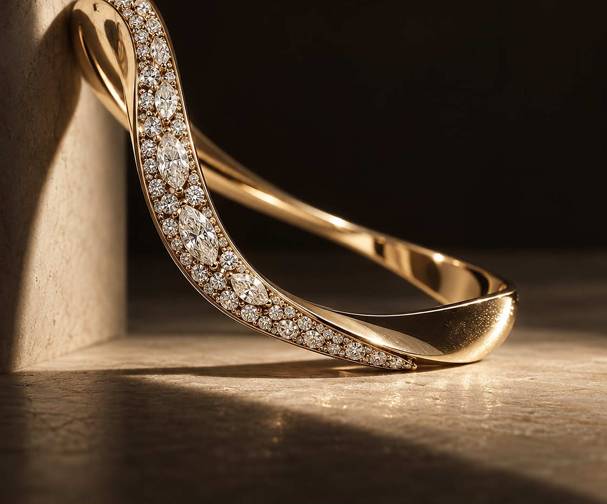

# ARAYE — Fine Jewellery, Dubai

A boutique fine-jewellery website built as a single static page. No build step, no framework, no dependencies to install — open `index.html` or deploy the folder to any static host.



---

## What this is

ARAYE is a private-appointment jewellery house in Dubai. The site presents:

- **The Curves Collection** — signature pieces in a dark editorial gallery
- **Bespoke commissions** — a five-step private process with hover previews
- **Compose Your Piece** — an interactive 3D diamond configurator (Three.js)
- **Private consultations** — response-card inquiry form

Design language: charcoal rooms, warm neutrals, champagne-gold accents, serif-led typography. Built around the concept of *"first light"* — the name ARAYE derives from the Kazakh word for the glow of dawn.

---

## Quick start

### Local preview
```bash
# Any static server works
python3 -m http.server 8931
# or
npx serve .
```
Open `http://localhost:8931`

### Deploy
Upload these files to any static host:

| File | Purpose |
|------|---------|
| `index.html` | The site |
| `araye.js` | Motion, configurator, 3D engine |
| `three.min.js` | Three.js r149 |
| `assets/` | Product photography |

No server code. No environment variables. Works on Netlify, Vercel, Cloudflare Pages, S3, GitHub Pages, cPanel — anything that serves files.

**Vercel (one click):**
```bash
npx vercel --prod
```
The included `vercel.json` handles caching and security headers automatically.

---

## Structure

```
├── index.html          # Single-page site
├── araye.js            # Vanilla JS controller (IIFE, no globals)
├── three.min.js        # Three.js r149 (only dependency)
├── assets/             # Product images (2–3x upscaled, progressive JPEG)
│   └── originals/      # Source images (archived, not deployed)
├── vercel.json         # Cache rules + security headers
├── .vercelignore       # Excludes design source from deploys
└── .gitignore          # Excludes internals from git
```

---

## Key features

| Feature | Implementation |
|---------|---------------|
| **Responsive** | Mobile-first, 390px–1440px verified. Typography scales with `clamp()`, touch targets ≥48px |
| **Motion** | IntersectionObserver reveals, condensing header, cursor-following previews. Honors `prefers-reduced-motion` |
| **3D configurator** | Lazy-initialized Three.js scene. Six diamond shapes, four piece types, three metals. Full teardown on page exit |
| **Performance** | Images lazy-loaded, hero preloaded, progressive JPEGs, no render-blocking scripts |
| **Accessibility** | Semantic HTML, focus states, alt text, color-contrast checked |
| **SEO** | Open Graph tags, theme-color, SVG favicon |

---

## Customization

### Contact details
Search for `[YOUR EMAIL]`, `[YOUR NUMBER]`, `[YOUR HANDLE]` in `index.html` and `araye.js` — replace with real values.

### Images
Replace files in `assets/`. Keep filenames identical to avoid code changes. For best quality, source at least 2× the display size (e.g., 2880px wide for a 1440px hero).

### The 3D stone
The configurator builds geometry procedurally. To change shapes, edit `stoneGeos()` in `araye.js`. To add metals, extend the color map in `apply3d()`.

---

## Browser support

- Chrome/Edge 88+
- Safari 14+
- Firefox 85+
- iOS Safari 14+ (uses `100svh`, `aspect-ratio`, `IntersectionObserver`)

No IE11. No polyfills shipped.

---

## License

Proprietary. All rights reserved. Design and code for ARAYE Fine Jewellery.
